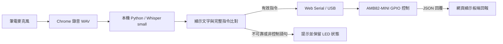

# AMB82-MINI 本機語音控制 LED

使用筆電麥克風輸入中文語音，在 Mac 本機以 Whisper 辨識，再透過 Chrome Web Serial／USB 控制 AMB82-MINI 板上的藍燈與綠燈。

本儲存庫只包含目前執行系統需要的程式與環境說明。模型和 Python 虛擬環境會在本機建立，沒有包含先前的練習或測試程式。

## 功能

| 語音指令 | 動作 |
|---|---|
| 左邊開燈 | 藍燈亮，保留綠燈狀態 |
| 右邊開燈 | 綠燈亮，保留藍燈狀態 |
| 左邊關燈 | 藍燈滅 |
| 右邊關燈 | 綠燈滅 |
| 左邊閃爍三次 | 藍燈先滅，再亮／滅三次，最後保持熄滅 |
| 右邊閃爍三次 | 綠燈先滅，再亮／滅三次，最後保持熄滅 |
| 通訊中斷 | 停止收音與控制、取消閃爍，關閉 USB 序列連線 |

- 顯示辨識文字、執行情形與開發板回覆，可匯出操作紀錄。
- 按住說話、放開後辨識；一次說一條指令，最長錄音 10 秒。
- 語音辨識在本機運算；錄音不送雲端，也不寫入檔案。
- 指令完整比對，支援繁／簡體及「三次／3次」。例如「不要左邊開燈」「左邊開燈右邊開燈」不會執行。
- 無法辨識、可靠度不足或非控制語句不會送出 LED 控制指令。
- 通訊失敗時停止收音及後續控制，顯示提示，燈號標記為「未知」。

## 系統架構



這是本機應用程式，不能只用 GitHub Pages 執行整套功能；HTML 頁面需要搭配 Python 語音服務與實體 USB 開發板。

## 硬體與環境

| 項目 | 使用設定 |
|---|---|
| 開發板 | AMB82-MINI，RTL8735B |
| 藍燈 | `LED_B`，Arduino 腳位 23，GPIO PF9 |
| 綠燈 | `LED_G`，Arduino 腳位 24，GPIO PE6 |
| 亮滅邏輯 | HIGH 亮、LOW 滅 |
| 作業系統 | macOS，Apple Silicon |
| 開發工具 | Arduino IDE 2.3.10 |
| 已使用板卡套件 | AmebaPro2 4.1.1-build20260915 |
| Python | 本專案使用 Python 3.13.5 |
| 語音套件 | faster-whisper 1.2.1 |
| 語音模型 | 多語系 Whisper small，CPU / int8 |
| 瀏覽器 | 桌面版 Google Chrome，需支援 Web Serial |
| 序列通訊 | 115200 baud |

準備可傳輸資料的 Micro USB 線，連接 AMB82-MINI 的 UART USB 接口。其他型號不可直接套用這份腳位設定。

## 安裝與啟動

### 1. 取得程式

```sh
git clone https://github.com/Angus9312/ameba-mini-voice-led.git
cd ameba-mini-voice-led
```

也可以使用 GitHub 的 **Code → Download ZIP**，下載後解壓縮。

### 2. 安裝板卡支援並上傳韌體

若 Arduino IDE 尚未安裝 AMB82-MINI 支援，依照 [官方入門文件](https://ameba-doc-arduino-sdk.readthedocs-hosted.com/en/latest/ameba_pro2/amb82-mini/Getting_Started/Getting%20Started%20with%20Ameba.html)設定 AmebaPro2 板卡套件。

1. 在 Arduino IDE 開啟 [03_voice_led.ino](firmware/03_voice_led/03_voice_led.ino)。
2. 選擇 **AMB82-MINI** 與對應的連接埠。
3. 點 **Verify（驗證／編譯）**。此步驟在電腦執行，不需要操作板子按鍵。
4. 手動上傳模式：按住 `UART_DOWNLOAD`，按下並放開 `RESET`，最後放開 `UART_DOWNLOAD`，再點 **Upload（上傳）**。
5. 上傳成功後按一下 `RESET` 啟動程式。
6. **關閉 Arduino 的 Serial Monitor（序列埠監控視窗）及 Serial Plotter（序列繪圖器）**，讓網頁可以使用連接埠。

### 3. 啟動本機網站

在專案資料夾的終端機執行：

```sh
zsh start.command
```

啟動檔會建立 `.venv`、安裝 `requirements.txt` 套件並啟動網站。首次使用會下載 Whisper small 模型，約數百 MB；下載完成後優先從本機載入，不需 API 金鑰。

使用 Chrome 開啟 **http://127.0.0.1:8765**，並保持終端機視窗開啟。不要直接雙擊 `index.html`，也不要重複啟動同一個服務。

若要手動建立環境：

```sh
python3 -m venv .venv
source .venv/bin/activate
python -m pip install -r requirements.txt
python server.py
```

[requirements-macos-tested.txt](requirements-macos-tested.txt) 記錄開發時使用的完整套件版本，可作為相同平台重現環境的參考。若需使用這些固定版本，可改以 `python -m pip install -r requirements-macos-tested.txt` 安裝。

### 4. 使用語音控制

1. 點「連接 AMB82-MINI」，選擇開發板的 USB 序列埠。
2. 等待「已連接」與「本機模型已就緒」。
3. 點「啟用麥克風」，允許 Chrome 存取筆電麥克風。
4. 按住「按住說話」，說出一條指令後放開；也可按住空白鍵錄音。
5. 檢查辨識文字及板端回覆，同時觀察實體 LED。

## 停止與異常處理

- 「通訊中斷」須在放開錄音、辨識完成後才生效，並非背景持續監聽。要立刻停止操作，使用畫面上的「停止並斷線」。
- 停止會取消板端閃爍並保留當下電位，不等於兩顆燈熄滅。要全滅，請先分別關燈。
- 每秒查詢板端狀態，正常指令等待回覆最多約 1.5 秒；不會自動重送 LED 控制指令。
- 拔除 USB 或回覆逾時時，網頁停止控制並顯示未知狀態。若停止指令無法送達，介面不會宣稱板子已停止。
- 開發板仍有供電且 3 秒未收到有效主機指令時，會取消閃爍、保留當下輸出；USB 拔除若同時斷電，實體燈會熄滅。
- 停止後，尚在 CPU 上執行的辨識可能繼續到完成，但結果會被忽略，不再送出指令。

**網頁顯示的是開發板回報的 GPIO 輸出狀態，並非光學量測。** 是否真的發光，仍需觀察實體 LED。

## 常見問題

| 問題 | 處理方式 |
|---|---|
| 無法開啟序列埠 | 關閉 Arduino 監控視窗、其他占用 USB 的程式或另一個已連線的網頁 |
| 回覆逾時／韌體版本不符 | 確認上傳本儲存庫的 `03_voice_led.ino`，並按 RESET |
| 沒有語音模型 | 首次保持網路連線，等待模型下載；失敗原因可在終端機查看 |
| 麥克風無法使用 | 檢查 Chrome 網站與 macOS 麥克風權限 |
| 辨識文字出現但沒有執行 | 可能不是完整支援的句子，或可靠度不足；在安靜環境逐句重試 |
| Address already in use | 已有服務占用 8765；確認現有服務後直接開啟網頁，避免重複啟動 |

## 原始碼結構

```text
ameba-mini-voice-led/
├── firmware/03_voice_led/03_voice_led.ino  # 板端控制與 JSON 回覆
├── web/
│   ├── index.html                        # 中文控制介面
│   ├── style.css                         # 響應式版面
│   ├── app.js                            # 麥克風、USB、狀態與紀錄
│   ├── protocol.mjs                      # 指令比對、JSON 驗證、WAV 封裝
│   ├── audio-worklet.js                   # 錄音樣本擷取
│   └── favicon.svg
├── server.py                             # 本機網站與語音辨識
├── start.command                         # Mac 啟動檔
├── requirements.txt
├── requirements-macos-tested.txt
├── .gitignore
└── README.md
```

## 驗收建議

左右開燈各測五次，每次先將目標燈關閉，再記錄語句、辨識文字、板端回覆與肉眼燈號。另測左右閃爍三次、非控制語句、靜音、「通訊中斷」及實際拔除 USB。畫面上的「匯出紀錄」可保存操作紀錄；實體反應需另外記錄。

2026-09-24 的實際操作已在網頁紀錄中確認左右語音開關燈、左右閃爍的板端完成事件、語音斷線及重新連線。這不等於完成正式五次驗收，也不能代替肉眼觀察。

## 參考資料

- [AMB82-MINI 官方文件](https://ameba-doc-arduino-sdk.readthedocs-hosted.com/en/latest/ameba_pro2/amb82-mini/Getting_Started/Getting%20Started%20with%20Ameba.html)
- [Faster Whisper](https://github.com/SYSTRAN/faster-whisper)
- [Chrome Web Serial](https://developer.chrome.com/docs/capabilities/serial)
